# Diagrama entidade-relacionamento

Diagrama em Mermaid com as 29 tabelas, suas chaves primárias (PK), chaves estrangeiras (FK) e cardinalidades.

- **Linhas contínuas** são chaves estrangeiras declaradas no banco.
- **Linhas tracejadas** são chaves lógicas entre tabelas de log, sem `FOREIGN KEY` declarada.

As colunas exibidas são as chaves e alguns atributos de referência; a lista completa está no [dicionário de dados](dicionario_de_dados.md).

```mermaid
erDiagram
    canais ||--o{ investimento_diario : "investe em"
    canais ||--o{ contas : "adquire"
    canais |o--o{ cupons : "restringe"
    contas |o--o{ contas : "indica"
    contas ||--|{ perfis : "tem"
    contas ||--o{ dispositivos : "registra"
    contas ||--|{ assinaturas : "assina"
    planos ||--o{ assinaturas : "plano atual"
    planos |o--o{ precos : "tem preço"
    assinaturas |o--o| assinaturas : "reativa (anterior)"
    assinaturas ||--o{ assinatura_eventos : "histórico"
    planos |o--o{ assinatura_eventos : "plano anterior/novo"
    assinaturas ||--o{ faturas : "cobra"
    contas ||--o{ faturas : "deve"
    precos ||--o{ faturas : "precifica"
    cupons ||--o{ cupom_resgates : "resgatado em"
    contas ||--o{ cupom_resgates : "resgata"
    assinaturas ||--o{ cupom_resgates : "aplica"
    cupom_resgates |o--o{ faturas : "desconta"
    faturas |o--o{ pagamentos : "paga"
    contas ||--o{ pagamentos : "efetua"
    assinaturas ||--o{ pesquisa_cancelamento : "motivo"
    contas ||--o{ pesquisa_cancelamento : "responde"
    estudios ||--o{ titulos : "produz/licencia"
    titulos ||--o{ episodios : "contém"
    titulos ||--|{ titulo_generos : "classificado"
    generos ||--o{ titulo_generos : "classifica"
    titulos ||--|{ titulo_elenco : "escala"
    pessoas ||--o{ titulo_elenco : "participa"
    titulos ||--|{ catalogo_disponibilidade : "janelas"
    perfis ||--o{ sessoes_app : "abre"
    dispositivos ||--o{ sessoes_app : "usado em"
    sessoes_app ||..o{ eventos_app : "sessao_id (lógica)"
    perfis ||--o{ eventos_app : "gera"
    titulos |o--o{ eventos_app : "referencia"
    sessoes_app |o..o{ reproducoes : "sessao_id (lógica)"
    perfis ||--o{ reproducoes : "assiste"
    dispositivos ||--o{ reproducoes : "toca em"
    titulos ||--o{ reproducoes : "reproduzido"
    episodios |o--o{ reproducoes : "episódio"
    reproducoes ||..o{ heartbeats_reproducao : "reproducao_id (lógica)"
    contas ||--o{ notificacoes : "recebe"
    perfis |o--o{ notificacoes : "destinatário"
    titulos |o--o{ notificacoes : "divulga"
    contas ||--o{ tickets_suporte : "abre"
    contas ||--o{ nps : "avalia"

    canais {
        smallint canal_id PK
        varchar codigo UK
    }
    investimento_diario {
        date data PK
        smallint canal_id PK,FK
    }
    planos {
        smallint plano_id PK
        varchar codigo UK
    }
    precos {
        int preco_id PK
        smallint plano_id FK
        date vigencia_inicio
    }
    contas {
        int conta_id PK
        varchar email UK
        varchar cpf UK
        smallint canal_aquisicao_id FK
        int indicada_por_conta_id FK
    }
    perfis {
        int perfil_id PK
        int conta_id FK
    }
    dispositivos {
        int dispositivo_id PK
        int conta_id FK
    }
    assinaturas {
        int assinatura_id PK
        int conta_id FK
        smallint plano_id FK
        int assinatura_anterior_id FK
    }
    assinatura_eventos {
        bigint evento_id PK
        int assinatura_id FK
        smallint plano_anterior_id FK
        smallint plano_novo_id FK
    }
    cupons {
        int cupom_id PK
        varchar codigo UK
        smallint canal_id FK
    }
    cupom_resgates {
        int resgate_id PK
        int cupom_id FK
        int conta_id FK
        int assinatura_id FK
    }
    faturas {
        bigint fatura_id PK
        int assinatura_id FK
        int conta_id FK
        int preco_id FK
        int cupom_resgate_id FK
    }
    pagamentos {
        bigint pagamento_id PK
        bigint fatura_id FK
        int conta_id FK
    }
    pesquisa_cancelamento {
        int resposta_id PK
        int assinatura_id FK
        int conta_id FK
    }
    generos {
        smallint genero_id PK
    }
    estudios {
        int estudio_id PK
    }
    pessoas {
        int pessoa_id PK
    }
    titulos {
        int titulo_id PK
        int estudio_id FK
    }
    titulo_generos {
        int titulo_id PK,FK
        smallint genero_id PK,FK
    }
    titulo_elenco {
        int titulo_id PK,FK
        int pessoa_id PK,FK
        varchar funcao PK
    }
    episodios {
        int episodio_id PK
        int titulo_id FK
    }
    catalogo_disponibilidade {
        int disponibilidade_id PK
        int titulo_id FK
    }
    sessoes_app {
        bigint sessao_id PK
        int perfil_id FK
        int dispositivo_id FK
    }
    eventos_app {
        bigint evento_id PK
        bigint sessao_id "lógica"
        int perfil_id FK
        int titulo_id FK
    }
    reproducoes {
        bigint reproducao_id PK
        int perfil_id FK
        bigint sessao_id "lógica"
        int dispositivo_id FK
        int titulo_id FK
        int episodio_id FK
    }
    heartbeats_reproducao {
        bigint heartbeat_id PK
        bigint reproducao_id "lógica"
    }
    notificacoes {
        bigint notificacao_id PK
        int conta_id FK
        int perfil_id FK
        int titulo_id FK
    }
    tickets_suporte {
        int ticket_id PK
        int conta_id FK
    }
    nps {
        int resposta_id PK
        int conta_id FK
    }
```

## Cardinalidades principais

| Relação | Cardinalidade | Observação |
|---|---|---|
| contas → perfis | 1 : 1..5 | Toda conta tem um perfil principal. |
| contas → dispositivos | 1 : 0..N | |
| contas → assinaturas | 1 : 1..N | Cada reativação cria uma nova assinatura. |
| assinaturas → assinaturas (anterior) | 0..1 : 0..1 | Encadeamento de reativações. |
| assinaturas → faturas | 1 : 0..N | Um ciclo de cobrança por fatura; assinatura que não sai do trial não tem fatura. |
| faturas → pagamentos | 1 : 0..N | Uma linha por tentativa, reembolso ou contestação. |
| cupom_resgates → faturas | 1 : 0..N | Uma fatura por ciclo com desconto. |
| titulos → episodios | 1 : 0..N | Somente séries têm episódios. |
| titulos → catalogo_disponibilidade | 1 : 1..N | Um título pode sair e voltar ao catálogo. |
| sessoes_app → eventos_app / reproducoes | 1 : 0..N | Chave lógica. |
| reproducoes → heartbeats_reproducao | 1 : 0..N | Apenas perfis com telemetria detalhada. |
